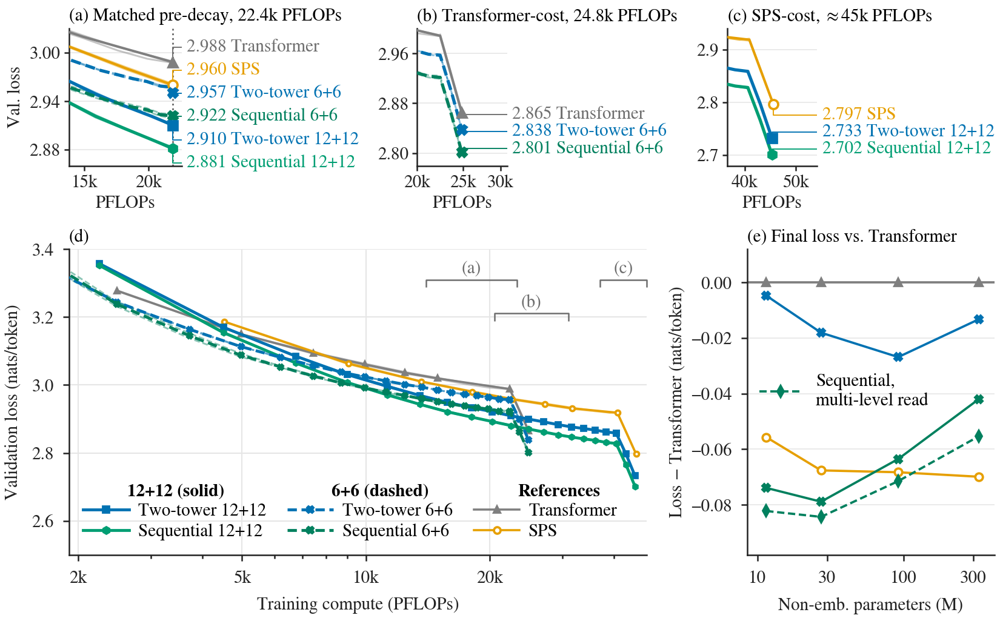
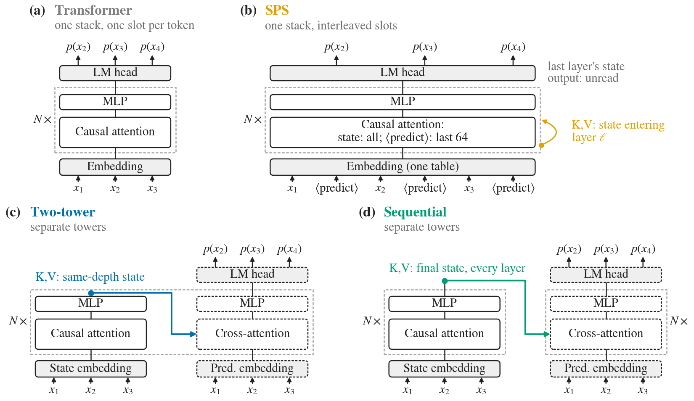

# Which State Should Prediction Read?

Code, configs and results for *Which State Should Prediction Read? A Mechanistic Analysis of
State–Prediction Separation* (Ryan Kim, 2026).

**Paper:** [paper.pdf](paper/paper.pdf) | **Checkpoints:** [`ryankim17920/mechanistic-sps`](https://huggingface.co/ryankim17920/mechanistic-sps)

<p align="center">
  
</p>

Validation loss against training compute (a–d), and final loss minus the Transformer's at
four sizes from 11.5M to 327M non-embedding parameters (e). Sequential (green) beats the
Transformer and Two-tower at every budget and every size.

State–Prediction Separation (SPS) gives persistent state and next-token prediction separate
token slots but shares all their weights. We give the two streams separate weights and trace
how information is written and read: state heads record each token's predecessor, and
prediction heads match against that record. Prediction relies most on the latest state, yet
SPS never reads its top state layer. This motivates **Sequential**, where every prediction
layer reads the final state, compared with **Two-tower**, where each prediction layer reads
the same-depth state.

<p align="center">
  
</p>

## Key results

Validation loss (nats/token, FineWeb-Edu, 20B tokens, two-seed means):

| Model | Two-tower | Sequential | Non-emb. params | GFLOPs/token |
|---|---|---|---|---|
| 12+12 | 2.733 | **2.702** | 184.1M | 0.751 |
| 6+6 | 2.838 | **2.801** | 92.0M | 0.414 |
| Transformer (12L) | 2.865 | | 92.0M | 0.414 |
| SPS | 2.797 | | 92.0M | 0.756 |

- At equal non-embedding parameters and FLOPs, Sequential beats the Transformer at every size
  from 11.5M to 327M, by 0.042–0.079 nats/token, and has higher zero-shot accuracy on eight tasks.
- Sequential 12+12 beats a 24-layer Transformer (2.756), and Sequential 6+6 matches SPS
  within 0.005 at 55% of its FLOPs.

## Quick start

```bash
uv sync                  # Python 3.10, PyTorch 2.9
make paper               # rebuild every table and figure from the committed results (CPU, minutes)
make check               # golden gates
python scripts/dualsps/hf_export.py download s_two_tower_seq6_20b   # a trained checkpoint
```

Training (one 8×H100 node per run), evaluation, the mechanistic analyses, the mapping from
each paper figure/table to its command, and the corpus and data order are in
[`docs/REPRODUCIBILITY.md`](docs/REPRODUCIBILITY.md).
Tests: `uv run python -m pytest`.

## License

MIT. The model code started from the SPS reference implementation
([lil-lab/sps](https://github.com/lil-lab/sps), see `UPSTREAM.md`); the vendored figure fonts
in `src/plotting/fonts/` carry their own licenses.

## Citation

```bibtex
@misc{kim2026whichstate,
  title  = {Which State Should Prediction Read? A Mechanistic Analysis of State--Prediction Separation},
  author = {Ryan Kim},
  year   = {2026}
}
```

This work builds on SPS (Monea et al., 2026, [arXiv:2607.01218](https://arxiv.org/abs/2607.01218)).
